# Phase 4: Network Peering

## Objective
Connect two isolated customer VPCs (fintech and healthcare) to the shared VPC
using VPC Network Peering in a hub-and-spoke pattern, allow only the traffic
tenants need, and prove both connectivity **and** tenant isolation.

## What Was Built
- `customer-fintech-vpc` and `customer-health-vpc`, each in its own tenant project, built with the same reusable VPC module as the shared VPC
- Four peering connections (both directions for each tenant), all **ACTIVE**
- Custom routes **not** exchanged, so tenants learn subnet routes only
- Seven firewall rules: tenant → shared services on tcp:443, shared services → tenant callbacks on tcp:443, and IAP SSH in every VPC
- `sa-shared-svc` service account used as the firewall target for shared-services VMs
- Automated connectivity and isolation test: 7/7 PASS

```
                 shared-vpc-network (hub)
                 shared-svc-subnet 10.0.0.0/20
                  ▲                       ▲
     peering, tcp:443 only     peering, tcp:443 only
                  │                       │
customer-fintech-vpc               customer-health-vpc
10.100.0.0/20                      10.110.0.0/20
        └──────── ✗ no route between tenants ────────┘
```

## Configuration

### Tenant VPCs

| VPC | Project | Subnet | CIDR | Region | Flow logs |
|---|---|---|---|---|---|
| `customer-fintech-vpc` | `saas-tenant-fintech-2022` | `fintech-subnet` | 10.100.0.0/20 | us-central1 | On |
| `customer-health-vpc` | `saas-tenant-health-2022` | `health-subnet` | 10.110.0.0/20 | us-central1 | On |

Both use custom mode, MTU 1460 (matching the shared VPC), regional routing,
Private Google Access, and explicit `private-google-apis` and
`default-internet-egress` routes (the default route is deleted on creation).

### Peerings

| Peering | Network → Peer | Custom routes | State |
|---|---|---|---|
| `peer-shared-to-fintech` | shared-vpc-network → customer-fintech-vpc | Not exchanged | ACTIVE |
| `peer-fintech-to-shared` | customer-fintech-vpc → shared-vpc-network | Not exchanged | ACTIVE |
| `peer-shared-to-health` | shared-vpc-network → customer-health-vpc | Not exchanged | ACTIVE |
| `peer-health-to-shared` | customer-health-vpc → shared-vpc-network | Not exchanged | ACTIVE |

### Firewall rules

| VPC | Rule | Priority | Source | Target | Allow | Log |
|---|---|---|---|---|---|---|
| shared | `allow-iap-ssh` | 100 | 35.235.240.0/20 | all | tcp:22 | On |
| shared | `allow-fintech-to-shared-svc` | 2000 | 10.100.0.0/16 | SA `sa-shared-svc` | tcp:443 | On |
| shared | `allow-health-to-shared-svc` | 2010 | 10.110.0.0/16 | SA `sa-shared-svc` | tcp:443 | On |
| fintech | `allow-iap-ssh` | 100 | 35.235.240.0/20 | all | tcp:22 | On |
| fintech | `allow-shared-svc-callbacks` | 2000 | 10.0.0.0/20 | all | tcp:443 | On |
| health | `allow-iap-ssh` | 100 | 35.235.240.0/20 | all | tcp:22 | On |
| health | `allow-shared-svc-callbacks` | 2000 | 10.0.0.0/20 | all | tcp:443 | On |

Only allows are added in this phase. GCP's implied rule already denies all
other ingress. Logged deny-all and egress rules come in Phase 5.

### Files

| File | Purpose |
|---|---|
| `terraform/vpc_peering.tf` | Tenant VPCs (module `for_each`) and the four peerings |
| `terraform/firewall_rules.tf` | Peering-related firewall rules |
| `scripts/04-peering-prereqs.sh` | Creates `sa-shared-svc`, enables IAP in tenant projects |
| `scripts/04-connectivity-test.sh` | Creates test VMs, runs the test matrix, deletes VMs |

## Verification

### Connectivity and isolation test

Three `e2-micro` test VMs with no external IPs (`svc-test-vm` at 10.0.0.2,
`fintech-test-vm` at 10.100.0.2, `health-test-vm`) were probed over IAP SSH:

| Test | Expected | Actual | Result | Why |
|---|---|---|---|---|
| fintech → shared-svc :443 | OPEN | OPEN | PASS | peering + `allow-fintech-to-shared-svc` |
| health → shared-svc :443 | OPEN | OPEN | PASS | peering + `allow-health-to-shared-svc` |
| shared-svc → fintech :443 | OPEN | OPEN | PASS | `allow-shared-svc-callbacks` |
| shared-svc → health :443 | OPEN | OPEN | PASS | `allow-shared-svc-callbacks` |
| fintech → health :443 | BLOCKED | BLOCKED | PASS | no route: peering is non-transitive |
| health → fintech :443 | BLOCKED | BLOCKED | PASS | no route: peering is non-transitive |
| fintech → shared-svc :22 | BLOCKED | BLOCKED | PASS | only tcp:443 allowed from tenants |

**7 passed, 0 failed.** Firewall logs confirm the allowed flow:
`10.100.0.2 → 10.0.0.2:443`, `disposition: ALLOWED`, matched by `allow-fintech-to-shared-svc`.

### Commands

| Check | Command |
|---|---|
| Peering state | `gcloud compute networks peerings list --network=shared-vpc-network --project=saas-vpc-host-2022` |
| Terraform outputs | `terraform apply -refresh-only -auto-approve && terraform output` |
| Firewall rules | `gcloud compute firewall-rules list --project=saas-vpc-host-2022 --filter="network~shared-vpc-network"` |
| Tests | `bash scripts/04-connectivity-test.sh` |

### Screenshots

#### Terraform

**Plan: 19 resources to add**
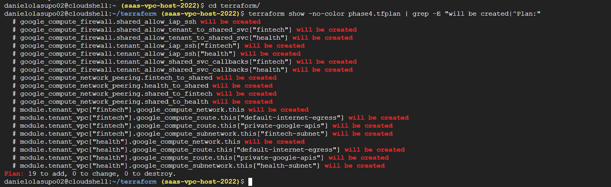

**Apply complete**
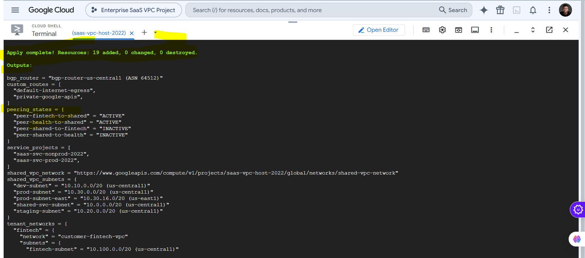

**Outputs after refresh: all four peerings ACTIVE, tenant networks created**
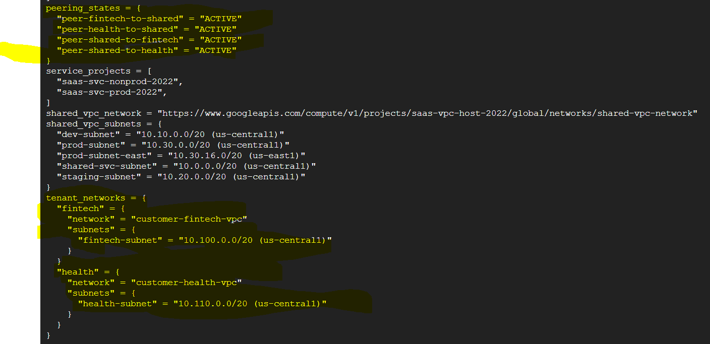

#### Tenant VPCs

**Fintech VPC**
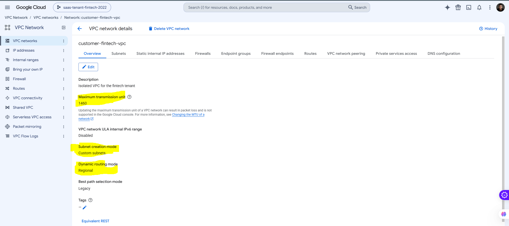

**Healthcare VPC**
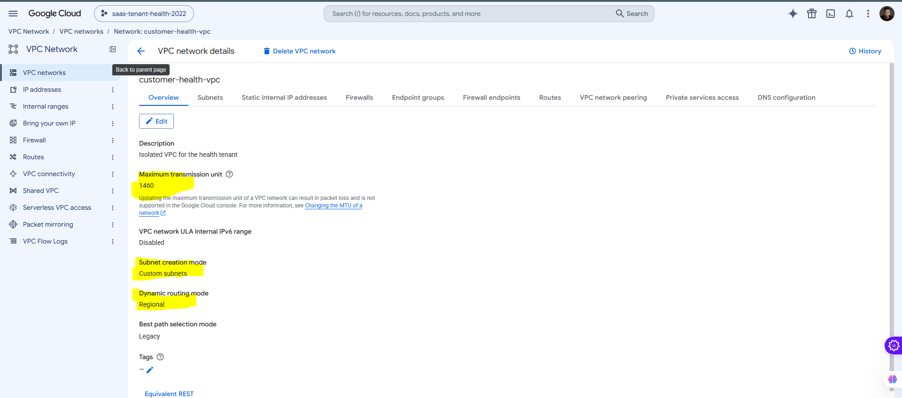

**Fintech subnet (10.100.0.0/20, flow logs on)**
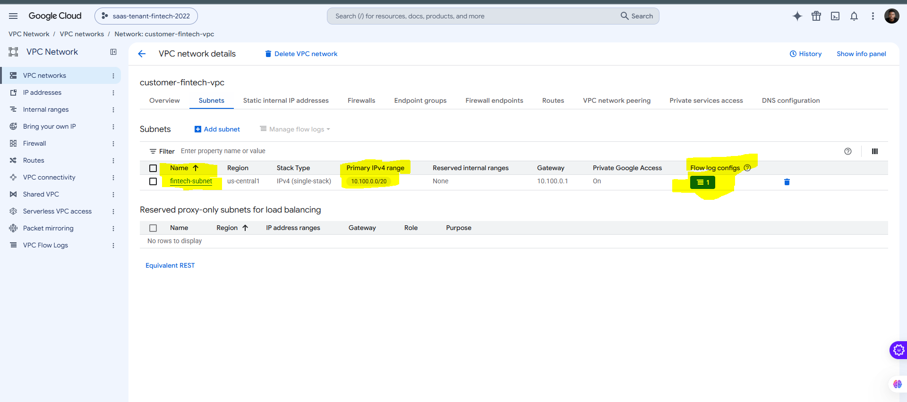

**Healthcare subnet (10.110.0.0/20, flow logs on)**
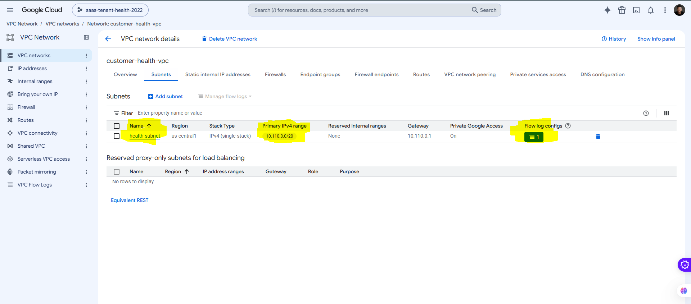

#### Peering

**Hub side: both peerings Active**
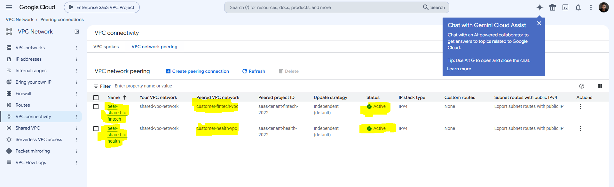

**Fintech side**
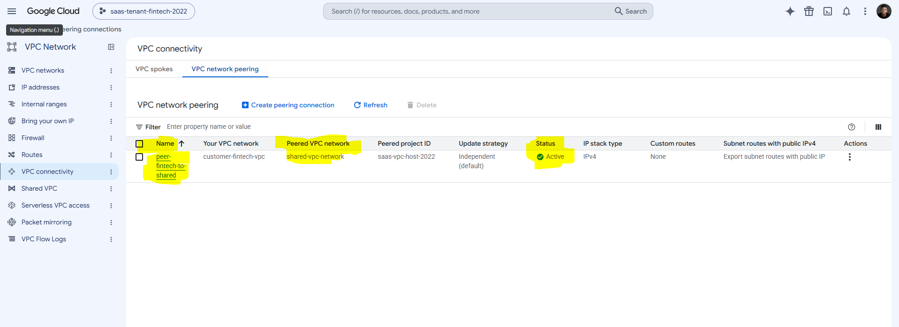

**Healthcare side**
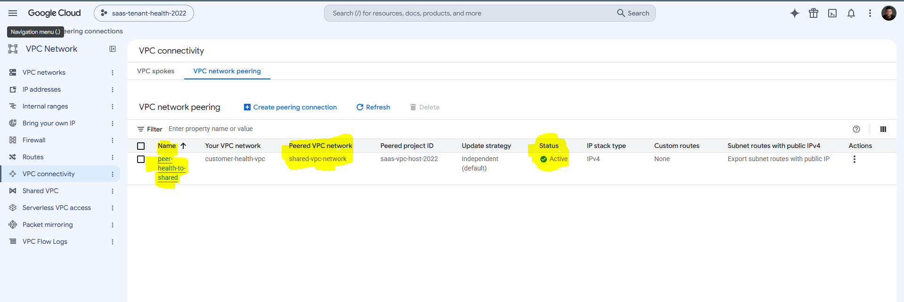

**Fintech VPC routes: only explicit static routes; nothing custom is imported over peering**
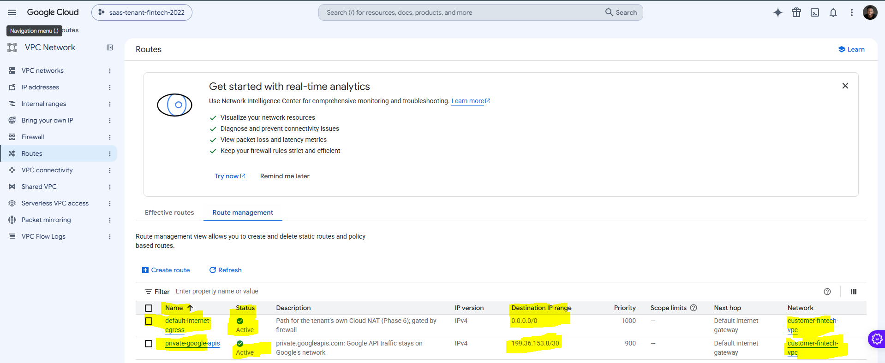

#### Firewall

**Shared VPC firewall rules**
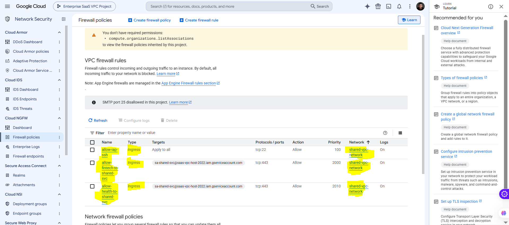

**`allow-fintech-to-shared-svc`: source 10.100.0.0/16 → service account target, tcp:443**
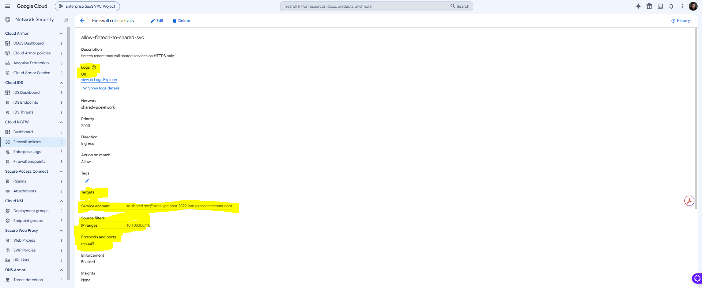

**Tenant firewall rules (fintech)**
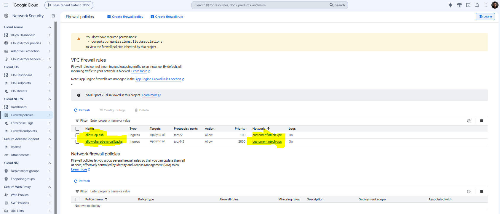

**`sa-shared-svc`: the identity firewall rules target**
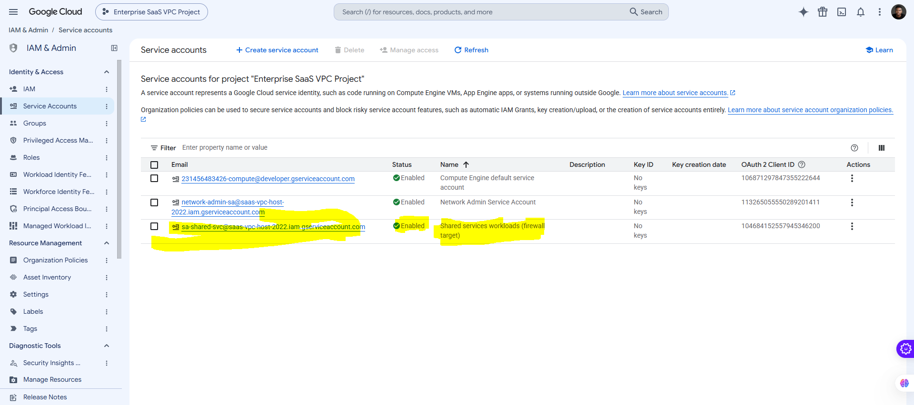

#### Testing

**Connectivity and isolation test: 7/7 PASS**
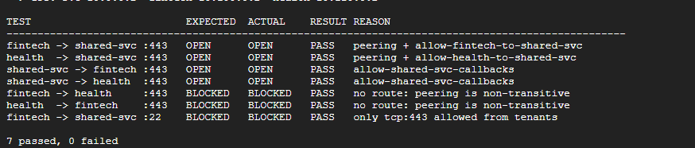

**Test VMs: no external IPs**
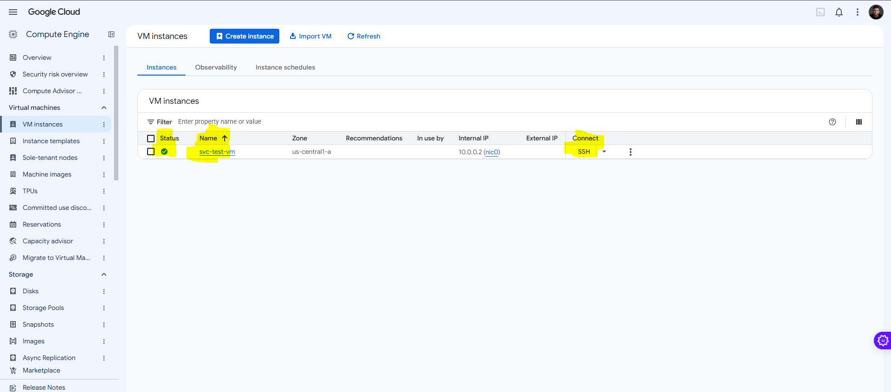
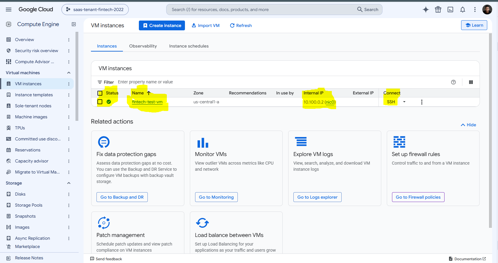
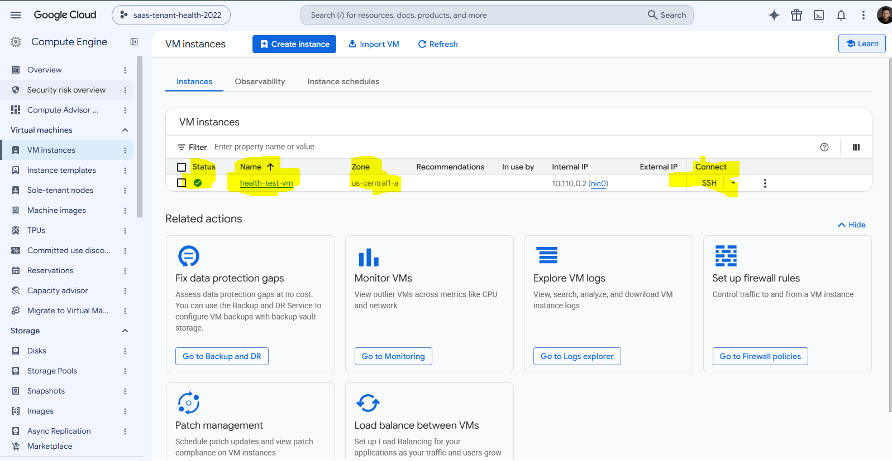

**Firewall log: fintech → shared services allowed on 443**
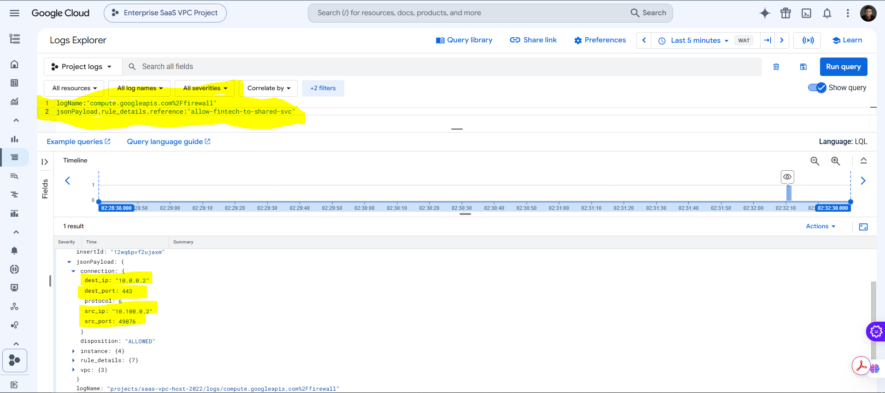

## Notes & Issues

### Two peerings showed `INACTIVE` after apply
Terraform records a peering's state when it creates it. `peer-shared-to-fintech`
was created before the reverse peering existed, so Google reported it as
`INACTIVE` at that moment. Running `terraform apply -refresh-only` re-read the
real state and all four peerings showed `ACTIVE`. The infrastructure was correct
the whole time; only Terraform's saved copy was stale.

### Test VMs failed: "network resource cannot be found"
The connectivity test ran after `terraform plan` but before `terraform apply`.
A plan only previews changes, so the tenant networks didn't exist yet. Applying
the plan and re-running the (idempotent) test script fixed it.

### Duplicate Terraform files after a browser upload
Uploading updated files to Cloud Shell one by one created `variables_(1).tf`
and `outputs_(1).tf` alongside the originals. Terraform loads every `.tf` file,
so this would cause duplicate declarations. The `(1)` versions were renamed
over the originals and stale `.tfplan` files were deleted before re-planning.

### `Permission denied` running scripts
The zip didn't preserve the executable bit. Fixed with `chmod +x scripts/*.sh`,
and recorded in Git with `git update-index --chmod=+x`.

### Decisions
- **Peerings are created one at a time** (chained `depends_on`). GCP allows only one peering operation per network at a time, and every peering touches the shared VPC.
- **Custom routes are not exchanged.** Tenants never learn the shared VPC's internet route or, later, on-prem BGP routes.
- **One firewall rule per tenant** (`allow-fintech-…`, `allow-health-…`), so each tenant's access can be audited and revoked on its own.
- **Firewall targets a service account, not a tag.** Changing a VM's service account requires IAM permission; changing a tag doesn't.
- **Same VPC module for every network.** Onboarding a tenant is one new entry in `local.tenants` plus its two peerings.
