# Phase 5: Security Controls

## Objective
Enforce zero trust across the whole platform: deny everything by default, allow
only named flows between named identities, stop risky configurations at the
organization level, keep DNS and Google API traffic private, restrict admin
access to IAP, and monitor posture with Security Command Center.

## What Was Built

49 Terraform resources: 48 created and 1 imported.

## Configuration

### Organization guardrails

| Control | Setting | Purpose |
|---|---|---|
| Hierarchical firewall `org-baseline-policy` | 1000 goto_next IAP → tcp:22,3389 | Let IAP admin traffic reach VPC rules |
| | 1100 deny 0.0.0.0/0 → tcp:22,3389 | SSH/RDP from anywhere else denied org-wide |
| | 1200 / 1210 deny 10.100/16 ↔ 10.110/16 | Tenants can never reach each other (defence in depth on non-transitive peering) |
| `compute.vmExternalIpAccess` | Deny all | No VM can get a public IP |
| `compute.requireOsLogin` | Enforced | SSH access tied to IAM identities |
| `iam.disableServiceAccountKeyCreation` | Enforced | No long-lived keys; impersonation only |
| `compute.skipDefaultNetworkCreation` | Enforced | New projects never get the permissive `default` network |
| `compute.restrictVpcPeering` | `under:organizations/172544480375` | Peering only with networks inside the org |

### Workload identities

| Service account | Project | Used by |
|---|---|---|
| `sa-prod-app` | `saas-svc-prod-2022` | Production VMs |
| `sa-staging-app` | `saas-svc-nonprod-2022` | Staging VMs |
| `sa-dev-app` | `saas-svc-nonprod-2022` | Dev VMs |
| `sa-shared-svc` | `saas-vpc-host-2022` | Shared services VMs (Phase 4) |

### Shared VPC firewall

| Priority | Rule | Dir | Source / destination | Target | Action |
|---|---|---|---|---|---|
| 100 | `allow-iap-ssh` | In | 35.235.240.0/20 | all | tcp:22 |
| 110 | `allow-health-checks` | In | 35.191.0.0/16, 130.211.0.0/22 | prod, shared-svc | tcp:80,443,8080 |
| 500 | `deny-nonprod-to-prod` | In | 10.10/16, 10.20/16 | `sa-prod-app` | **Deny** |
| 510 | `deny-tenants-to-envs` | In | 10.100/16, 10.110/16 | all env SAs | **Deny** |
| 1000–1020 | `allow-{env}-internal` | In | own env /16 | env SA | tcp:443,8080 |
| 1030 | `allow-envs-to-shared-svc` | In | 10.10, 10.20, 10.30 /16 | `sa-shared-svc` | tcp:443 |
| 2000/2010 | `allow-{tenant}-to-shared-svc` | In | tenant /16 | `sa-shared-svc` | tcp:443 |
| 65000 | `deny-all-ingress` | In | 0.0.0.0/0 | all | **Deny** |
| 1000 | `allow-egress-google-apis` | Out | 199.36.153.8/30 | all | tcp:443 |
| 1010 | `allow-egress-{env}-internal` | Out | own env /16 | env SA | tcp:443,8080 |
| 1020 | `allow-egress-to-shared-svc` | Out | 10.0.0.0/20 | env SAs | tcp:443 |
| 1030 | `allow-egress-shared-svc-to-tenants` | Out | tenant /16s | `sa-shared-svc` | tcp:443 |
| 4000 | `deny-egress-private-ranges` | Out | 10/8, 172.16/12, 192.168/16 | all | **Deny** |
| 4100 | `allow-egress-internet-https` | Out | 0.0.0.0/0 | env + shared SAs | tcp:443 |
| 65000 | `deny-all-egress` | Out | 0.0.0.0/0 | all | **Deny** |

Every deny rule and every rule crossing a trust boundary has logging on.

### Tenant VPC firewall (same baseline for each tenant)

| Priority | Rule | Dir | Destination / source | Action |
|---|---|---|---|---|
| 100 | `allow-iap-ssh` | In | 35.235.240.0/20 | tcp:22 |
| 2000 | `allow-shared-svc-callbacks` | In | 10.0.0.0/20 | tcp:443 |
| 65000 | `deny-all-ingress` | In | 0.0.0.0/0 | **Deny** |
| 1000 | `allow-egress-google-apis` | Out | 199.36.153.8/30 | tcp:443 |
| 2000 | `allow-egress-to-shared-svc` | Out | 10.0.0.0/20 | tcp:443 |
| 4000 | `deny-egress-private-ranges` | Out | RFC 1918 ranges | **Deny** |
| 4100 | `allow-egress-internet-https` | Out | 0.0.0.0/0 | tcp:443 |
| 65000 | `deny-all-egress` | Out | 0.0.0.0/0 | **Deny** |

### Secure DNS

| Item | Value | Visible to |
|---|---|---|
| Zone `private-googleapis` (`googleapis.com.`) | `private.googleapis.com` A → 199.36.153.8–11; `*.googleapis.com` CNAME → private | shared + both tenant VPCs |
| Zone `saas-internal` (`saas.internal.`) | `api.saas.internal` A → 10.0.0.10 (reserved `shared-api-ip`) | shared + both tenant VPCs |
| DNS policy `dns-logging-policy` (one per project) | Logging on, inbound forwarding off | its own VPC |

DNSSEC applies only to public zones; both zones are private and unreachable from the internet.

### Admin access and detection

- **IAP + OS Login:** `scripts/05-security-prereqs.sh` grants the admin `iap.tunnelResourceAccessor` and `compute.osAdminLogin` on every project with VMs. This is kept out of Terraform so the Terraform identity never needs permission to edit IAM policies.
- **Security Command Center:** Standard tier, activated at the organization level, with Security Health Analytics enabled.

### Files

| File | Purpose |
|---|---|
| `terraform/security.tf` | Org firewall policy, org policies, VPC firewall baseline, DNS |
| `terraform/main.tf` | `environments` map: CIDR + service account per environment |
| `scripts/05-security-prereqs.sh` | Workload SAs, APIs, Terraform org roles, admin IAP/OS Login access |
| `scripts/05-security-test.sh` | 5 test VMs, 12-test security matrix, cleanup |

## Verification

### Security test (12/12 PASS)

VMs: `svc-test-vm` 10.0.0.3 · `fintech-test-vm` 10.100.0.3 · `health-test-vm` 10.110.0.3 · `prod-test-vm` 10.30.0.2 · `dev-test-vm` 10.10.0.2

| Test | Expected | Actual | Enforced by |
|---|---|---|---|
| prod → shared-svc :443 | OPEN | OPEN | `allow-envs-to-shared-svc` |
| dev → shared-svc :443 | OPEN | OPEN | `allow-envs-to-shared-svc` |
| fintech → shared-svc :443 | OPEN | OPEN | `allow-fintech-to-shared-svc` |
| shared-svc → fintech :443 | OPEN | OPEN | `allow-egress-shared-svc-to-tenants` |
| dev → prod :443 | BLOCKED | BLOCKED | `deny-egress-private-ranges` + `deny-nonprod-to-prod` |
| prod → dev :443 | BLOCKED | BLOCKED | `deny-egress-private-ranges` |
| fintech → prod :443 | BLOCKED | BLOCKED | tenant egress deny + `deny-tenants-to-envs` |
| fintech → health :443 | BLOCKED | BLOCKED | no route + org tenant deny |
| prod → shared-svc :22 | BLOCKED | BLOCKED | `deny-egress-private-ranges` (org SSH rule as backup) |
| DNS `storage.googleapis.com` | 199.36.153.x | 199.36.153.10 | `private-googleapis` zone |
| DNS `api.saas.internal` | 10.0.0.10 | 10.0.0.10 | `saas-internal` zone |
| VM with external IP | BLOCKED | BLOCKED | org policy `vmExternalIpAccess` |

Firewall logs confirm the blocks, for example
`10.10.0.2 → 10.30.0.2:443 DENIED by deny-egress-private-ranges`.
Security Command Center reports no misconfigurations, and the Security Essentials framework shows 100% of controls passing with 0 active findings.

### Commands

| Check | Command |
|---|---|
| No drift | `terraform plan` → `No changes` |
| Org policy | `gcloud org-policies describe iam.disableServiceAccountKeyCreation --organization=172544480375` |
| Org firewall rules | `gcloud compute firewall-policies rules list --firewall-policy=48120720576 --organization=172544480375` |
| DNS policy | `gcloud dns policies describe dns-logging-policy --project=saas-vpc-host-2022` |
| Tests | `bash scripts/05-security-test.sh` |

### Screenshots

#### Terraform

**Plan**
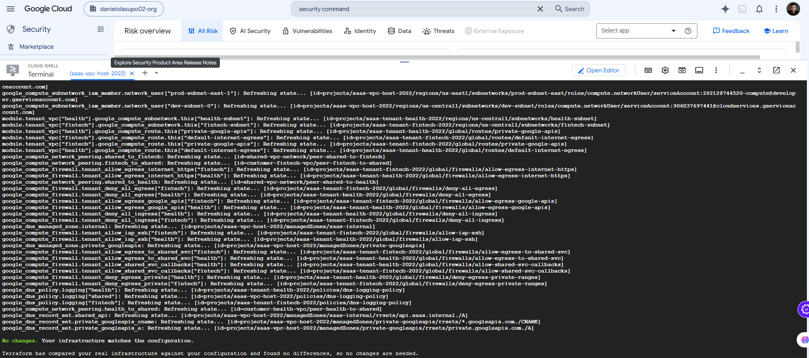

**Apply**
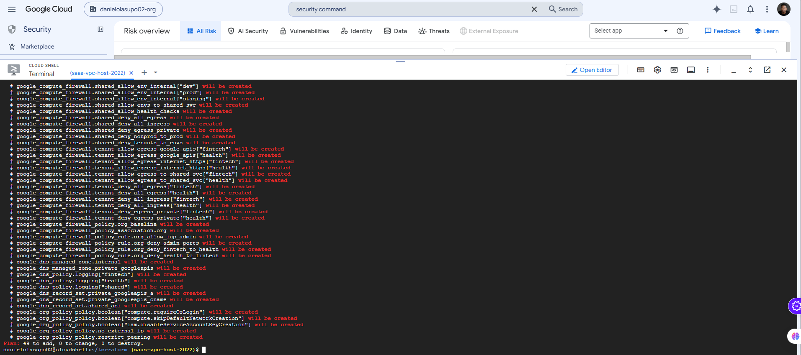

#### Organization guardrails

**Hierarchical firewall policy rules**
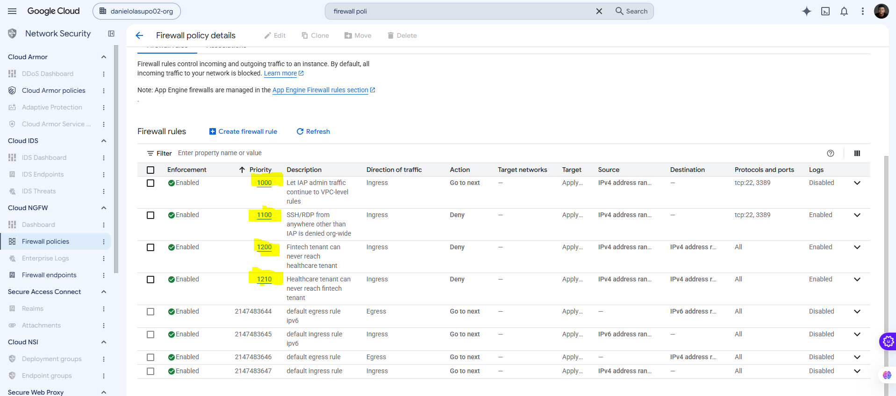

**Policy associated with the organization**
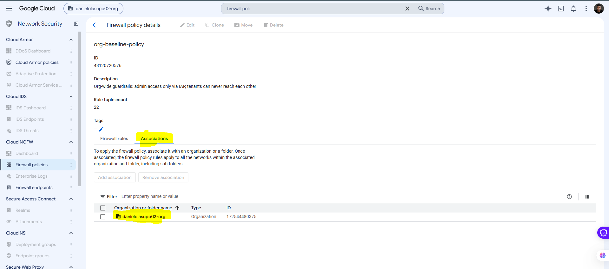

**Organization policy: no external IPs**
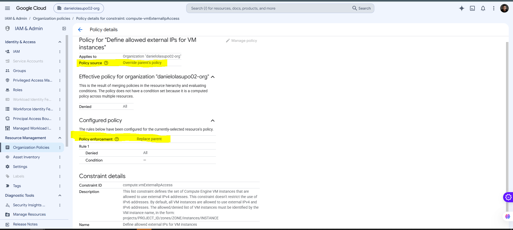

#### VPC firewalls and identities

**Shared VPC firewall: allows, isolation denies, default deny**
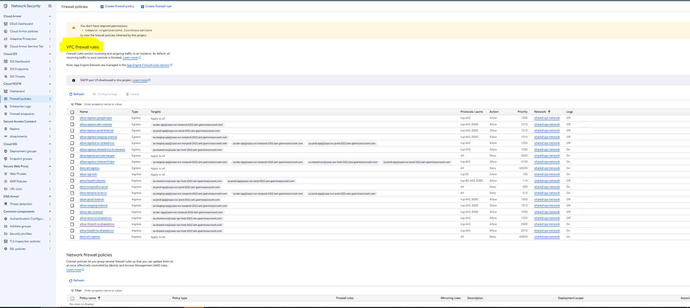

**`deny-nonprod-to-prod`: dev + staging → `sa-prod-app`, deny, logged**
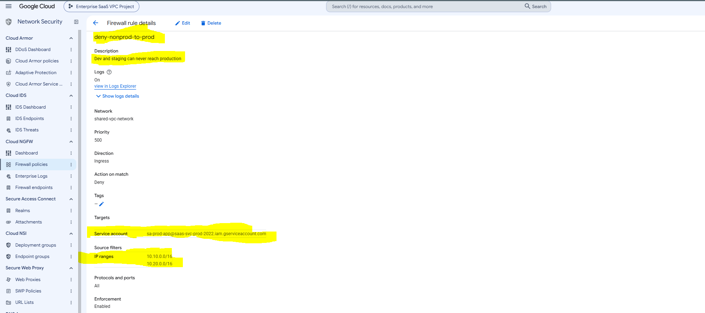

**Tenant firewall baseline**
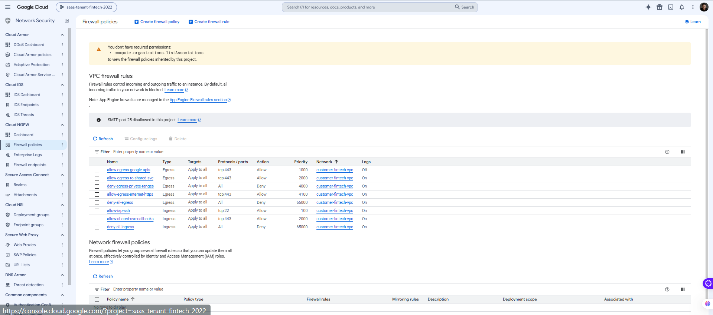

**Workload service accounts**
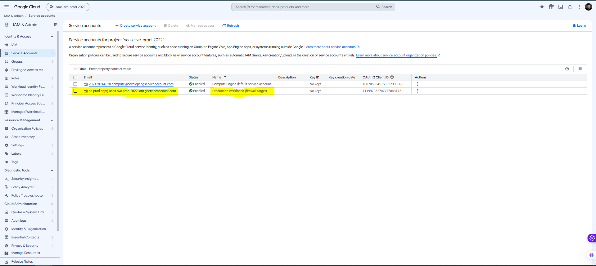

#### Secure DNS

**Private zones**
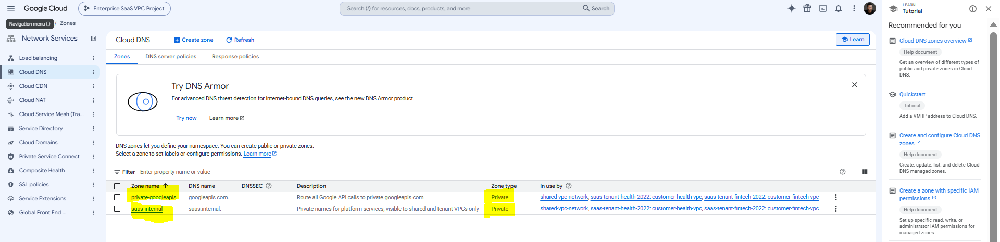

**`googleapis.com` → private VIP**
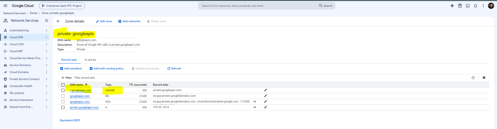

**`api.saas.internal` → 10.0.0.10**
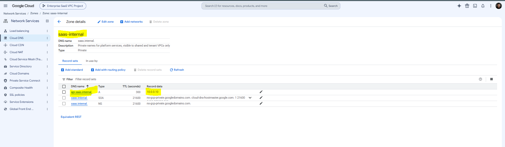

**DNS server policy: logging on, inbound forwarding off**
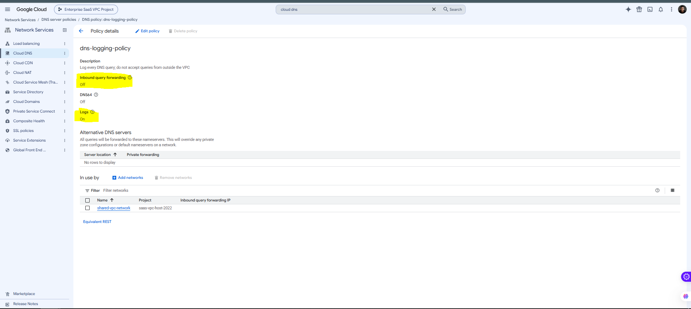

#### Access and detection

**IAP: VMs reachable only through IAP tunnels**
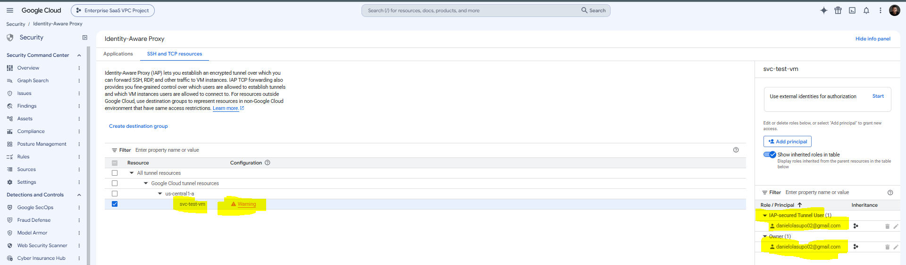

**Security Command Center overview: no misconfigurations**
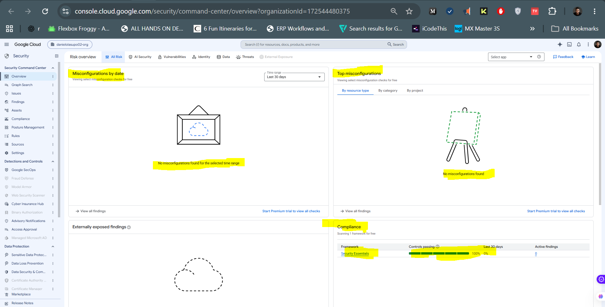

**Security Command Center posture: Security Essentials 100%, 0 findings**
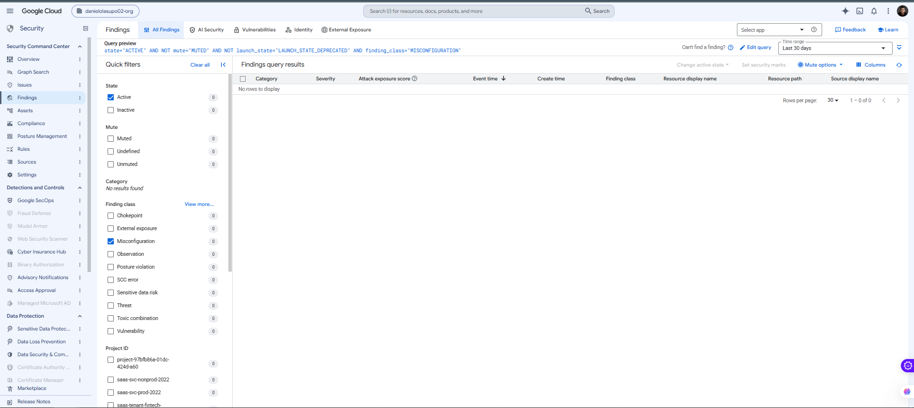

#### Testing and evidence

**Security test: 12/12 PASS**
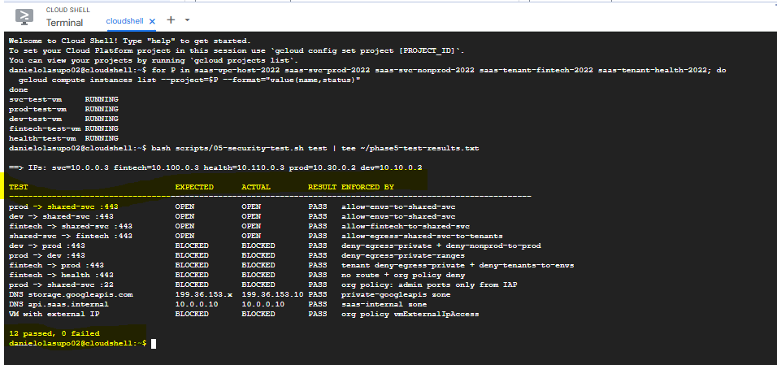

**Firewall log: dev → prod denied**
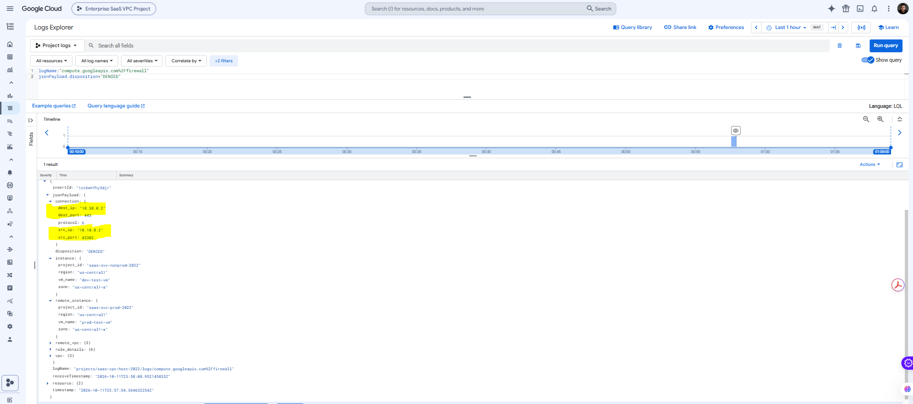

**DNS query log: Google API name answered with the private VIP**
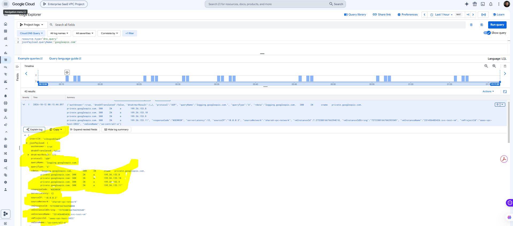

## Notes & Issues

### Org policy already existed (409)
`iam.disableServiceAccountKeyCreation` was already enforced by Google's
secure-by-default organization policies, so creating it returned
`409 POLICY_ALREADY_EXISTS`. It was brought under Terraform with
`terraform import`, and the next plan showed `No changes`.

### Org admin couldn't view SCC or org firewall policies
Organization Administrator manages IAM but not Compute or SCC resources. The
admin was granted `securitycenter.admin` (to activate SCC) and read-only
`compute.orgFirewallPolicyUser` and `orgpolicy.policyViewer`. Write access to
these resources stays with the Terraform service account only.

### Plan prompted for `org_id`, then hit `connection refused`
`org_id` was added to the example tfvars but not the real `terraform.tfvars`.
After it was added, the plan failed mid-refresh on a transient Cloud Shell
network error. Re-running with `-parallelism=1` completed cleanly.

### Shared VPC firewall logs live in the host project
DENIED logs for VMs in the nonprod and prod service projects appeared in
`saas-vpc-host-2022`, the project that owns the network, not in the VMs' projects.

### Defence in depth observed in logs
prod → shared-svc:22 was dropped at the source VM's egress
(`deny-egress-private-ranges`) before the org-level SSH deny was evaluated.
Either layer alone would block it.

### Decisions
- **Deny private ranges at 4000, allow internet HTTPS at 4100.** Any private destination not explicitly allowed is blocked; on-prem allows in Phase 6 (3000–3999) still win.
- **Admin IAM outside Terraform.** The Terraform SA can manage network and security resources, but never grant itself or anyone else access.
- **Health-check rule logging off.** It's high-volume, low-value traffic from Google's fixed ranges; this is an accepted trade-off.
- **Private DNS for Google APIs.** Combined with the Phase 3 route, API traffic never needs a public IP and never leaves Google's network.