# Phase 6: Egress Management and Hybrid Connectivity

## Objective
Give every environment and tenant a controlled, auditable path to the internet
through Cloud NAT with fixed public IPs. Connect a simulated on-premises network
over HA VPN with BGP, so routes are exchanged dynamically and on-prem sees only
shared services. Make NAT failover a tested, documented procedure.

## What Was Built

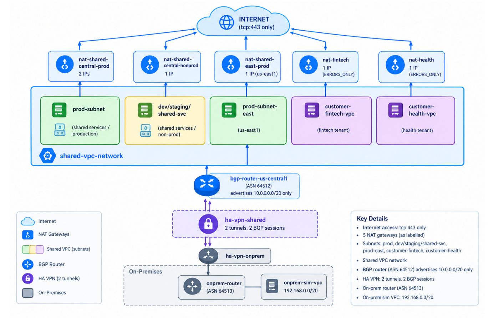

42 Terraform resources, plus a reusable `modules/egress` module (router, static IPs, NAT).

## Configuration

### Cloud NAT (one gateway per environment/tenant per region)

| Gateway | Project | Region | Subnets | Static IPs | Logging |
|---|---|---|---|---|---|
| `nat-shared-central-prod` | host | us-central1 | prod-subnet | 2 | ALL |
| `nat-shared-central-nonprod` | host | us-central1 | dev, staging, shared-svc | 1 | ALL |
| `nat-shared-east-prod` | host | us-east1 | prod-subnet-east | 1 | ALL |
| `nat-fintech` | fintech | us-central1 | all | 1 | ERRORS_ONLY |
| `nat-health` | health | us-central1 | all | 1 | ERRORS_ONLY |

All gateways use manual static IPs (`MANUAL_ONLY`), dynamic port allocation from
64 to 4096 ports per VM, and endpoint-independent mapping off.

### Egress routing policy
Internet egress takes three layers, each owned by a different control:
1. **Route:** `0.0.0.0/0` default route (Phases 3–4).
2. **NAT mapping:** the subnet decides which gateway, and so which public IP, is used.
3. **Firewall:** only tcp:443 to the internet, by service account (Phase 5, priority 4100). Everything else hits `deny-all-egress`.

Fixed per-tenant IPs let fintech and healthcare customers allowlist exactly the
IPs their data leaves from.

### Hybrid connectivity (HA VPN + BGP)

| Item | Shared VPC side | On-prem side |
|---|---|---|
| Network | `shared-vpc-network` | `onprem-sim-vpc` (192.168.0.0/20) |
| Cloud Router | `bgp-router-us-central1`, ASN 64512 | `onprem-router`, ASN 64513 |
| HA VPN gateway | `ha-vpn-shared` | `ha-vpn-onprem` |
| Tunnel 0 / BGP IPs | 169.254.0.1 | 169.254.0.2 |
| Tunnel 1 / BGP IPs | 169.254.1.1 | 169.254.1.2 |
| Advertises | Custom: 10.0.0.0/20 only | Default: 192.168.0.0/20 |

| Priority | Rule | Network | Effect |
|---|---|---|---|
| 3000 | `allow-onprem-to-shared-svc` | shared VPC | 192.168.0.0/20 → `sa-shared-svc` tcp:443 |
| 100 | `onprem-allow-iap-ssh` | on-prem | IAP admin SSH only |

The pre-shared key comes from `random_password` and is never written to the repo.
The whole VPN is toggled with `enable_hybrid_vpn` (about $0.20/hr while it's up).

### Monitoring
The host project is the metrics scope for prod, nonprod, fintech and health.
The dashboard **Egress & Hybrid Connectivity (Cloud NAT, HA VPN, BGP)** charts
NAT allocated ports, open connections, sent bytes, dropped packets, tunnel state
and BGP session state.

## Verification

### Egress and hybrid test (10/10 PASS)

NAT IPs: prod `34.132.81.101`, `34.60.101.104` · nonprod `34.133.166.161` · fintech `136.114.235.127` · health `34.172.190.175`

| Test | Expected | Actual | Enforced by |
|---|---|---|---|
| prod egress IP | one of the prod NAT IPs | 34.132.81.101 | `nat-shared-central-prod` |
| dev egress IP | 34.133.166.161 | 34.133.166.161 | `nat-shared-central-nonprod` |
| fintech egress IP | 136.114.235.127 | 136.114.235.127 | `nat-fintech` |
| health egress IP | 34.172.190.175 | 34.172.190.175 | `nat-health` |
| tenants have different IPs | different | different | per-tenant NAT |
| dev → internet :80 | BLOCKED | BLOCKED | tcp:443-only egress |
| BGP sessions up | 2 | 2 | HA VPN, 2 tunnels |
| shared VPC learned on-prem | 192.168.0.0/20 | 192.168.0.0/20 | BGP from `onprem-router` |
| on-prem → shared-svc :443 | OPEN | OPEN | VPN + `allow-onprem-to-shared-svc` |
| on-prem → prod :443 | BLOCKED | BLOCKED | only 10.0.0.0/20 advertised |

NAT logs show the translation end to end:
`src_ip 10.30.0.3:55794 → nat_ip 34.132.81.101:1024 → 172.67.74.152:443`, `allocation_status OK`, gateway `nat-shared-central-prod`.

### NAT failover (tested)

| Step | Action | Result |
|---|---|---|
| 1 | Prod leaves via `ip-0` | 34.132.81.101 |
| 2 | Drain `ip-0`, keep `ip-1` active (`gcloud ... nats update`) | NAT updated |
| 3 | Re-check after 60s | 34.60.101.104, **PASS**, no VM change |
| 4 | `terraform plan` | Drift detected: `+ nat-shared-central-prod-ip-0` |
| 5 | Release the drain pool, then `terraform apply` | Both IPs active, `No changes` |

The second region (`nat-shared-east-prod`) covers the loss of us-central1.

### Commands

| Check | Command |
|---|---|
| Tests | `bash scripts/06-egress-test.sh up && bash scripts/06-egress-test.sh test` |
| Failover | `bash scripts/06-egress-test.sh failover` |
| BGP status | `gcloud compute routers get-status bgp-router-us-central1 --region=us-central1 --project=saas-vpc-host-2022` |
| NAT IP pool | `gcloud compute routers nats describe nat-shared-central-prod --router=nat-router-shared-central-prod --region=us-central1 --format="yaml(natIps,drainNatIps)"` |
| NAT logs | Logs Explorer: `resource.type="nat_gateway"` (host project) |

### Screenshots

#### Terraform

**Plan (42 to add)**
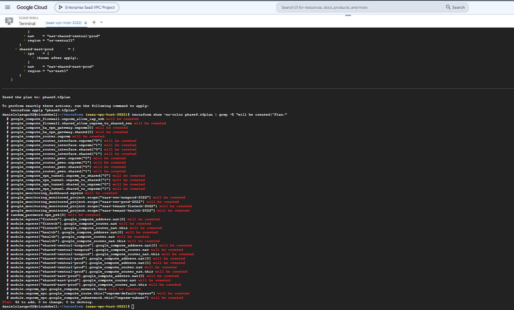

**Apply**
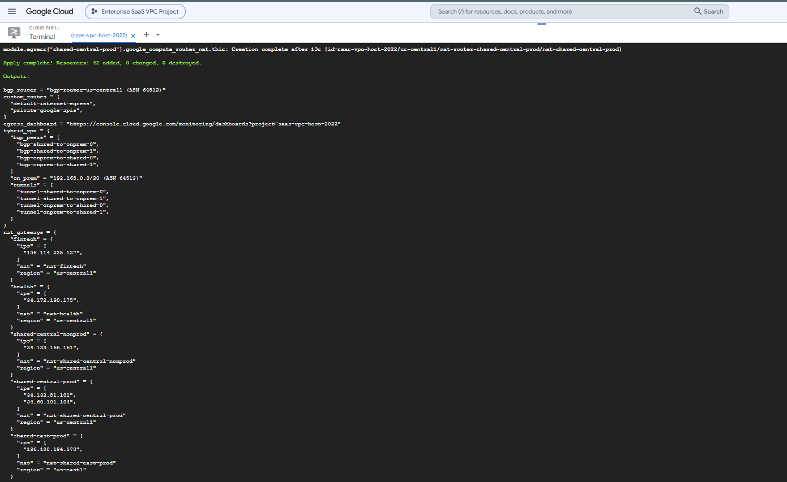

#### Cloud NAT

**NAT gateways in the host project**
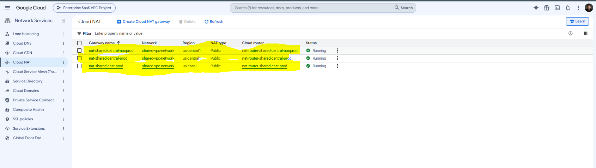

**Tenant NAT: fintech**
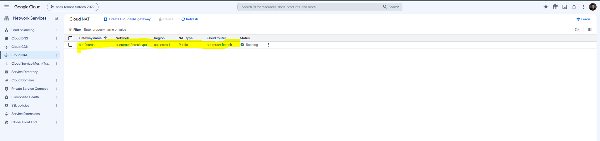

**Prod NAT detail: 2 manual IPs, prod-subnet only, dynamic ports, logging**
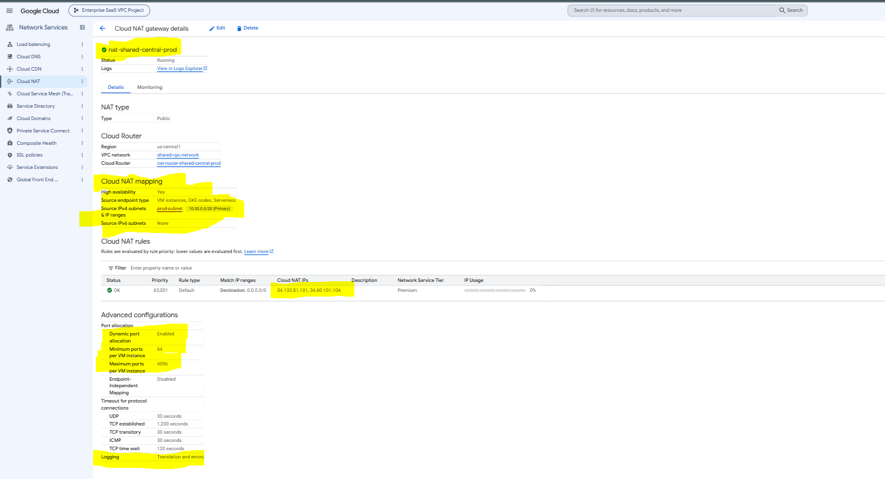

**Static external IPs in use by NAT**
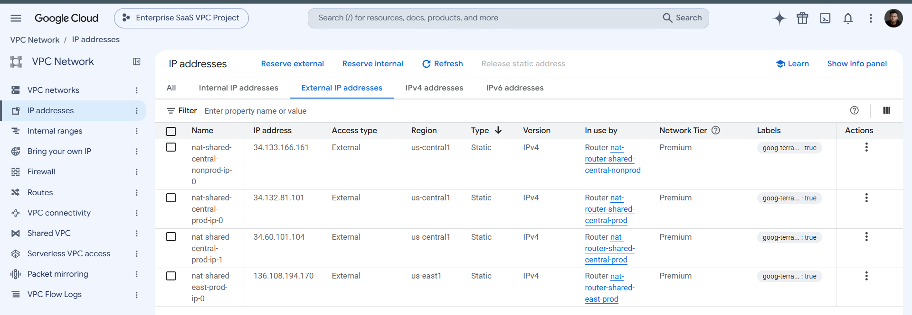

#### Hybrid connectivity

**HA VPN: 4 tunnels established**
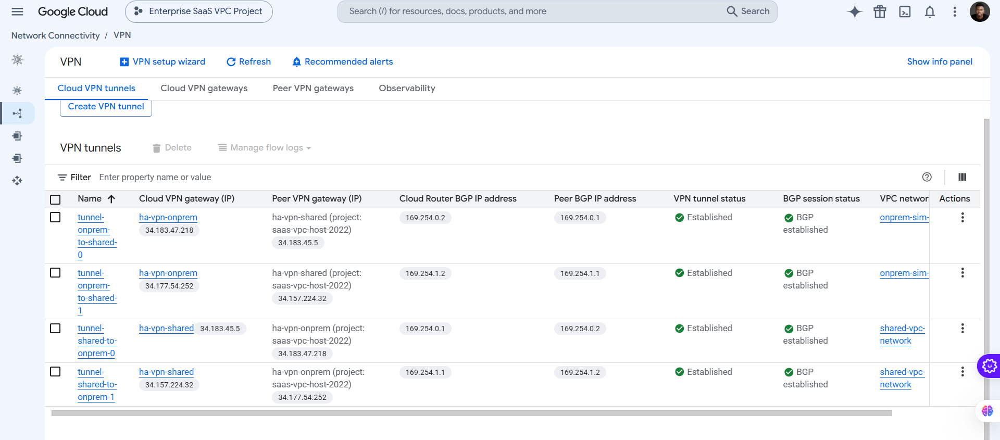

**Cloud Router: ASN 64512, custom advertisement 10.0.0.0/20, both BGP sessions Up**
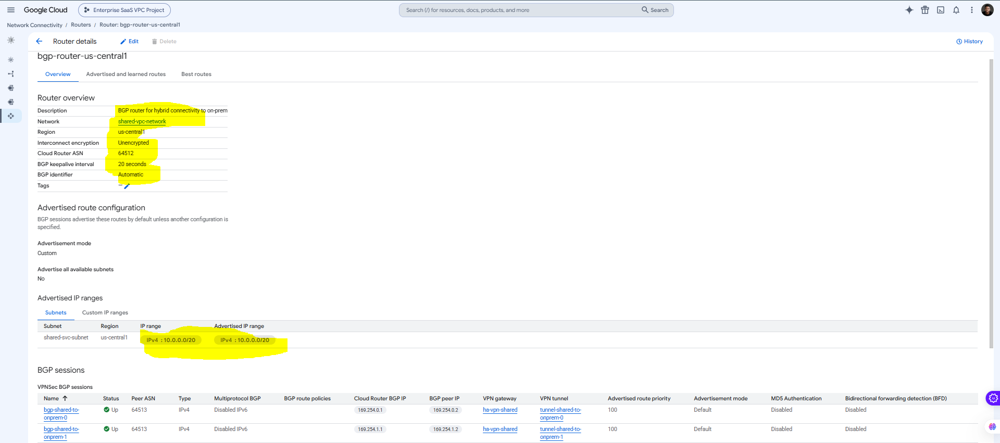

**Simulated on-prem VPC**
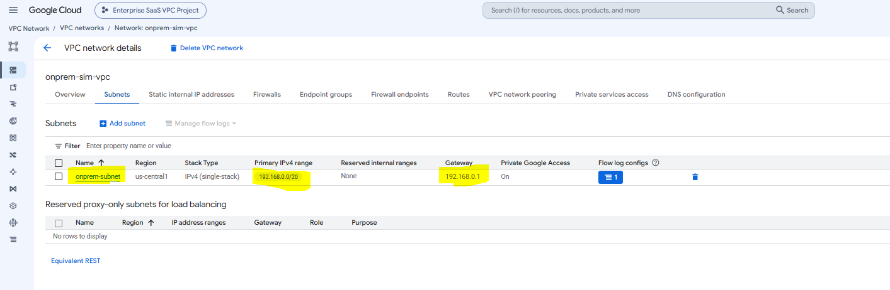

#### Monitoring and tests

**Egress dashboard**
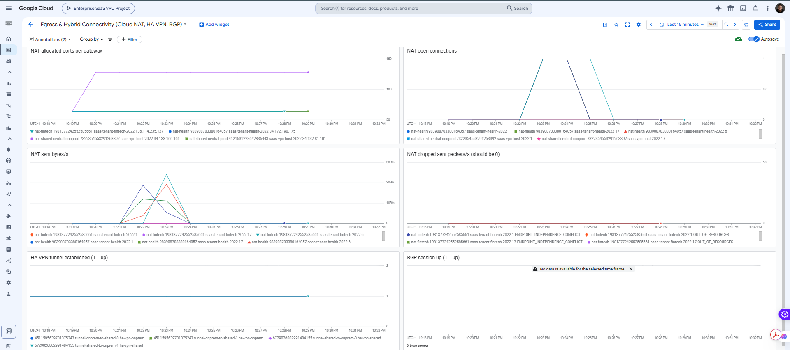

**Egress test: 10/10 PASS**
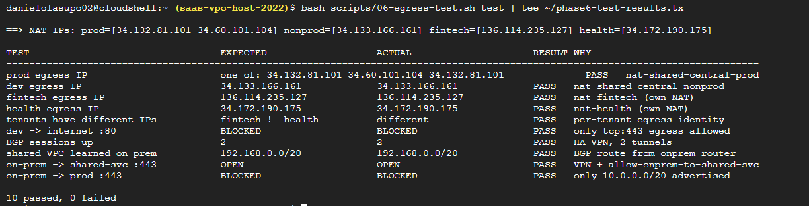

**NAT failover: egress moved to the second IP**
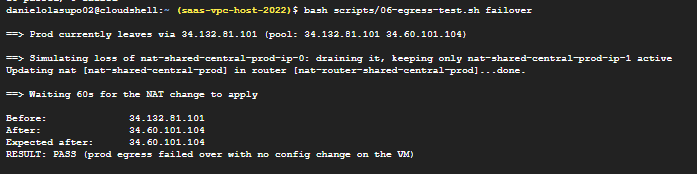

**Terraform detects the drift**
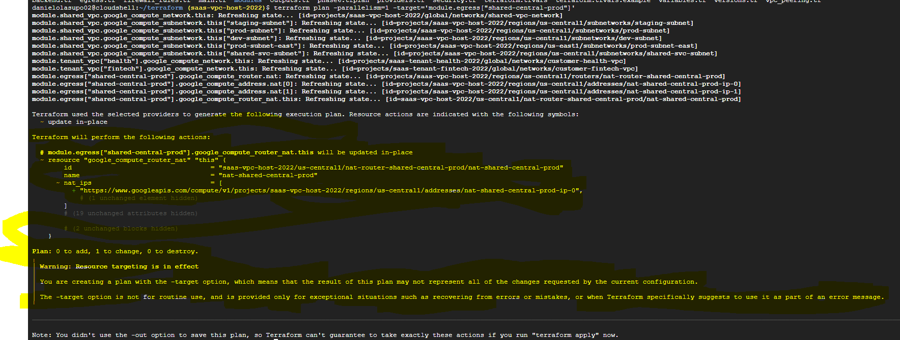

**Restored: both IPs active**
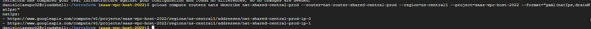

**NAT log: private source → static NAT IP → port 443**
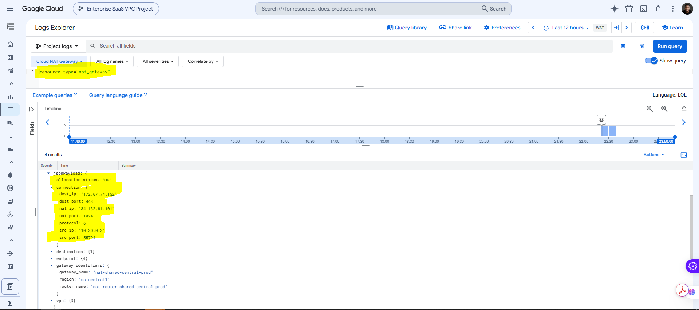

## Notes & Issues

### Restoring a drained NAT IP failed
`terraform apply` returned `400: Draining IP ... is already used`. The API won't
move an IP from the drain pool straight back to the active pool. Runbook: release
it first with `gcloud compute routers nats update ... --clear-nat-external-drain-ip-pool`,
then `terraform apply`. The `failover` command now prints both steps.

### Dashboard showed a permanent diff
The Monitoring API normalizes dashboard JSON: it drops `xPos`/`yPos` when they
are 0 and adds `targetAxis: "Y1"`. Terraform saw this as a change on every plan.
Fixed by generating JSON in the same shape the API stores.

### Test VMs missing
`test` failed with `svc-test-vm not found` because Phase 5 cleanup had deleted
them. Running `up` first recreated them.

### Cloud Shell drops
Uploads created `*_(1).tf` duplicates again (fixed with `mv -f`). A session reset
during `apply` lost the prompt; saving plans with `-out` and applying the plan
file avoided waiting on `yes`. `connection refused` errors were cleared with `-parallelism=1`.

### NAT logs appeared empty
Logs Explorer defaults to the last hour. Widening it to 12 hours showed the
entries. Tenant NATs log `ERRORS_ONLY`, so a clean run writes nothing there.

### Decisions
- **One NAT per environment and tenant.** Separate public identities, separate port budgets, and one tenant's traffic can't exhaust another's ports.
- **Two IPs on prod.** One can be drained for maintenance or reputation issues without an outage.
- **Full logging on shared gateways, errors only for tenants.** Full audit where we own the workload; lower cost and less data held for customer traffic.
- **On-prem sees only 10.0.0.0/20.** Hybrid access is limited by routing as well as firewall: prod and tenant ranges are never advertised.
- **VPN behind a toggle.** It's turned off after testing to stop tunnel charges; one variable brings it back.