# Phase 8: Automation, Backup and Disaster Recovery

## Objective
Make the network recoverable and hands-off. Pre-provision a DR region, back up
the live configuration somewhere a primary-region failure can't reach, prove
recovery with a measured drill, and move every change into a keyless CI/CD
pipeline with review and approval gates.

## What Was Built

| Area | What | Where |
|---|---|---|
| DR region (pilot light) | us-east1 standby subnets for shared services and both tenants (prod-east from Phase 3); shared-svc firewall rules and BGP adverts cover both regions; tenant DR NAT behind `enable_dr_egress` | `main.tf`, `vpc_peering.tf`, `security.tf`, `firewall_rules.tf`, `egress.tf` |
| DR guardrails | Plan fails if a network is missing a required region or has duplicate CIDRs | `terraform/modules/vpc/main.tf` |
| Config backup | Checksummed export of all network objects (5 projects + org) to a versioned bucket in us-east1; `backup`, `list`, `verify`, `diff <id> live` | `scripts/backup_config.sh`, `dr.tf` |
| DR runbook | RTO/RPO, 6 recovery scenarios, drill schedule and results | `docs/dr_network_config.md` |
| CI/CD | GitHub Actions: plan on PR (comment), apply on merge after approval, daily drift check + backup. Keyless via Workload Identity Federation | `.github/workflows/terraform.yml`, `scripts/08-cicd-prereqs.sh` |
| Tests | DR readiness matrix, plus a deletion drill that measures RTO | `scripts/08-dr-test.sh` |

The plan added 4 resources and changed 6 in place, with no destroys.

## Configuration

### DR address plan (us-east1)

| Network | Subnet | CIDR |
|---|---|---|
| `shared-vpc-network` | `prod-subnet-east` | 10.30.16.0/20 |
| `shared-vpc-network` | `shared-svc-subnet-east` | 10.0.16.0/20 |
| `customer-fintech-vpc` | `fintech-subnet-east` | 10.100.16.0/20 |
| `customer-health-vpc` | `health-subnet-east` | 10.110.16.0/20 |

Every DR range sits inside the environment's or tenant's existing /16, so the
/16-based firewall rules, org policy denies and service-account targeting
already cover it. The only rules that referenced a single /20 (shared services)
now use `local.shared_svc_ranges`.

### Backup

| Setting | Value |
|---|---|
| Bucket | `saas-vpc-host-2022-network-config-backups`, in **us-east1** (away from the primary region) |
| Protection | Object versioning; uniform access; public access prevention enforced |
| Retention | 180 days; at most 5 old versions per object |
| Contents | YAML/JSON exports, `MANIFEST.sha256`, archive checksum, metadata. Never secrets: no Terraform state (it holds the VPN PSK), VPN secrets redacted |
| Schedule | Daily 06:00 UTC from CI |

### CI/CD identity chain

```
GitHub OIDC token ─► WIF pool "github" / provider "github-oidc"
                     condition: assertion.repository == 'danielolasupo02/gcp-saas-vpc'
                 ─► github-ci-sa (workloadIdentityUser for that repo only)
                 ─► impersonates network-admin-sa (serviceAccountTokenCreator)
```

| Trigger | Jobs |
|---|---|
| Pull request | fmt → init → validate → plan → plan posted as a PR comment |
| Push to `main` | plan → **apply after approval** (environment `production`, required reviewer) |
| Daily 06:00 UTC | plan (fails on drift) + config backup |
| Manual | plan + backup |

Repository variables: `GCP_WIF_PROVIDER` and `GCP_CI_SA`. The only secret is `ALERT_EMAIL`.

## Verification

### DR readiness (8/8 PASS)

| Test | Expected | Actual |
|---|---|---|
| DR subnets in us-east1 | 4 | 4 |
| prod-east egress IP (east NAT) | 136.108.194.170 | 136.108.194.170 |
| prod-east → shared-svc-east :443 | OPEN | OPEN |
| fintech-east → shared-svc-east :443 | OPEN | OPEN |
| shared-svc-east → fintech-east :443 | OPEN | OPEN |
| fintech-east → prod-east :443 | BLOCKED | BLOCKED |
| fintech-east internet (DR NAT) | NONE | NONE (pilot light) |
| Latest config backup verifies | PASS | PASS |

### Deletion drill (PASS, RTO 249 s)

| Step | Result |
|---|---|
| Backup before the incident | `20261020T084922Z`, 62 files |
| Baseline shared-svc-east → fintech-east :443 | OPEN |
| Incident | `allow-shared-svc-callbacks` deleted in `saas-tenant-fintech-2022` |
| Impact | BLOCKED |
| Diagnose | `backup_config.sh diff` flagged `saas-tenant-fintech-2022/firewall-rules.yaml` |
| Detect | Alert "Network: change made outside Terraform", method `v1.compute.firewalls.delete` |
| Recover | `Plan: 1 to add`, Terraform apply |
| After restore | OPEN. **RTO 249 s** against a 15-minute target |

### Backup integrity
62 files exported with 4 expected export errors (Cloud DNS isn't used in the
service projects). `verify`: archive and all 64 file checksums match.

### CI/CD
| Run | Result |
|---|---|
| First run after setup | plan ✓, "No changes": CI and Cloud Shell agree |
| PR `dr: add owner label` | Plan comment: 1 to change |
| Merge to `main` | apply waited for approval, then `1 changed` |
| Manual run | plan ✓ (no changes), backup ✓ |

### Screenshots

#### Terraform

**Plan (4 to add, 6 to change, 0 to destroy)**
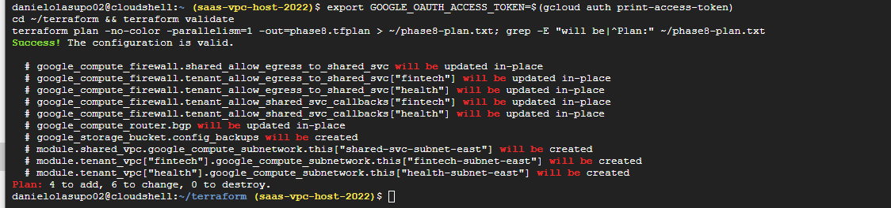

**Apply**
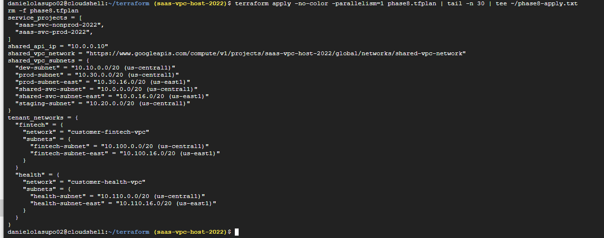

#### DR region

**Shared VPC DR subnets**
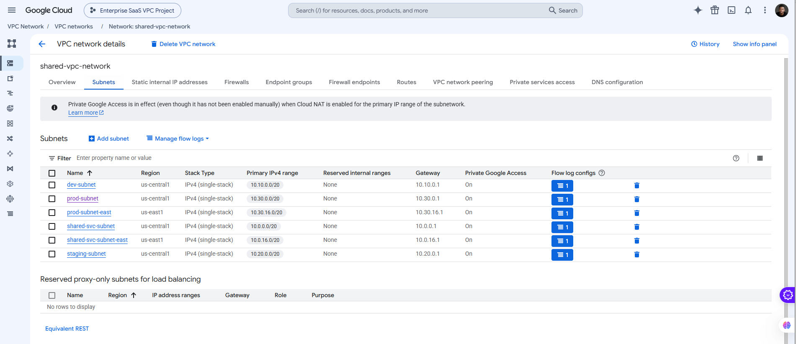

**Tenant DR subnet**
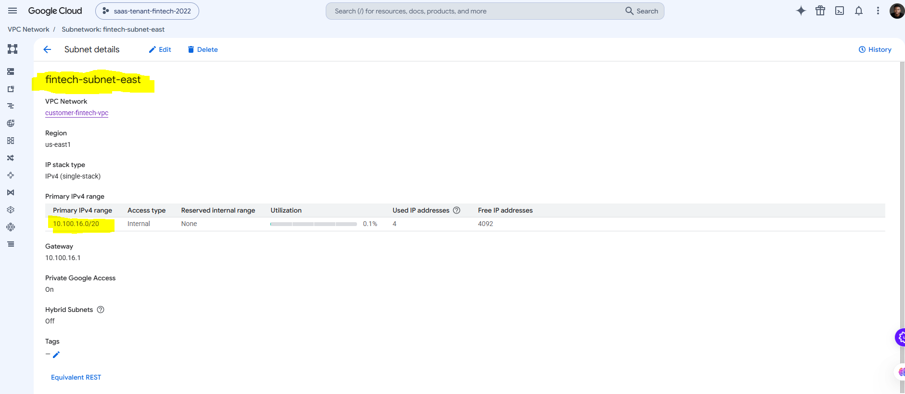

#### Backup

**Backup run**
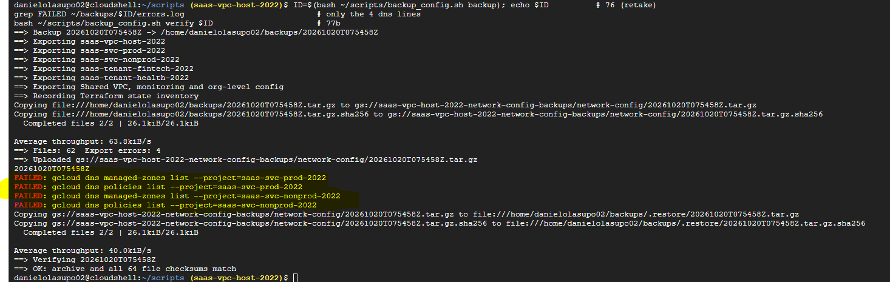

**Backup bucket in us-east1, versioned**
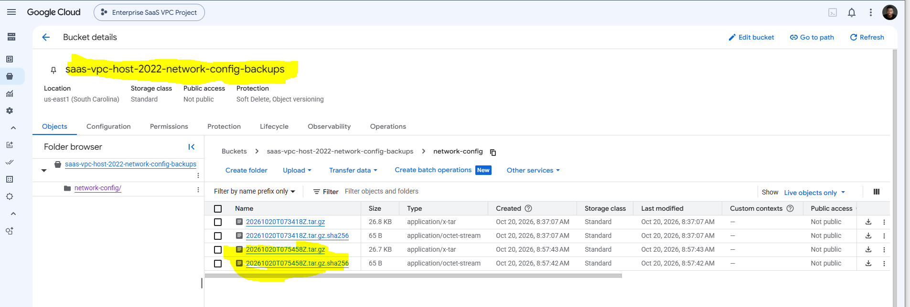

**Verify: all checksums match**
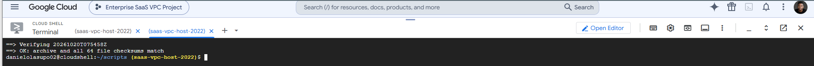

#### DR tests

**DR readiness: 8/8 PASS**
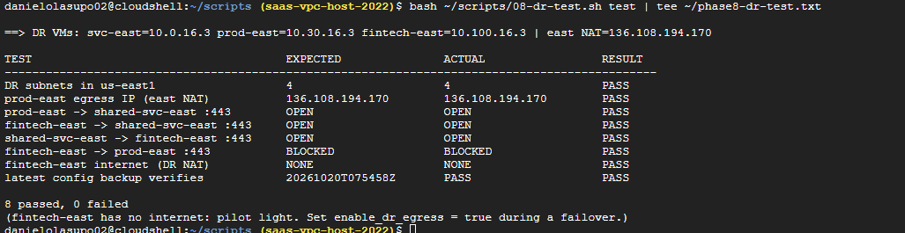

**Deletion drill: restored, RTO 249 s**
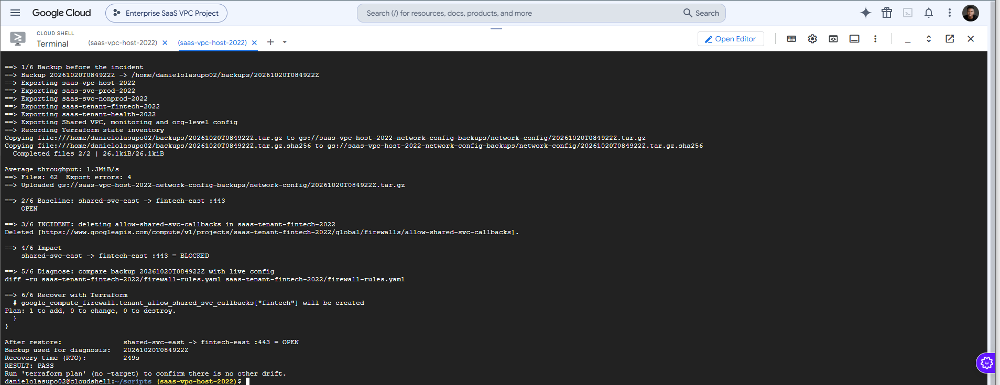

**Drift alert raised by the deletion**
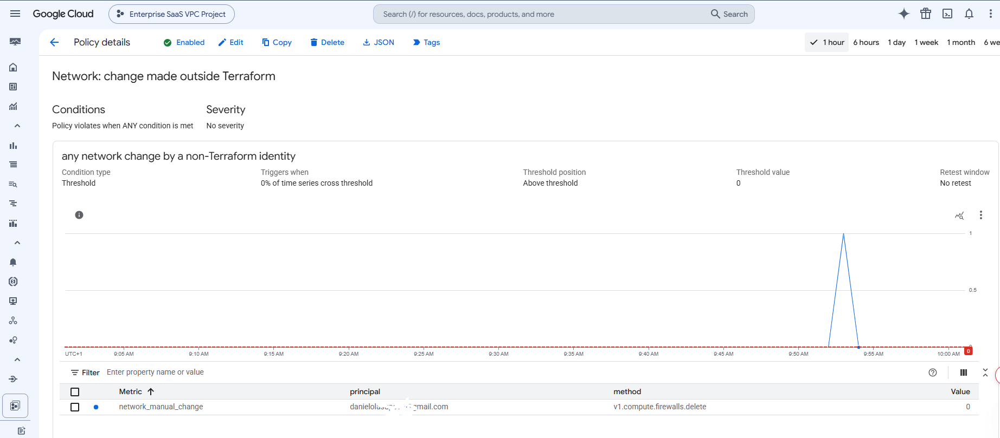

#### CI/CD

**First run: keyless auth, no changes**
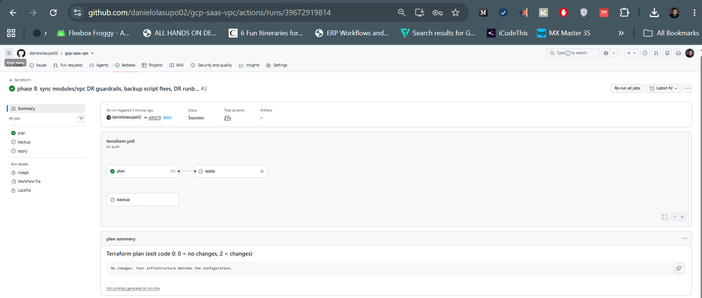

**Plan posted on the pull request**
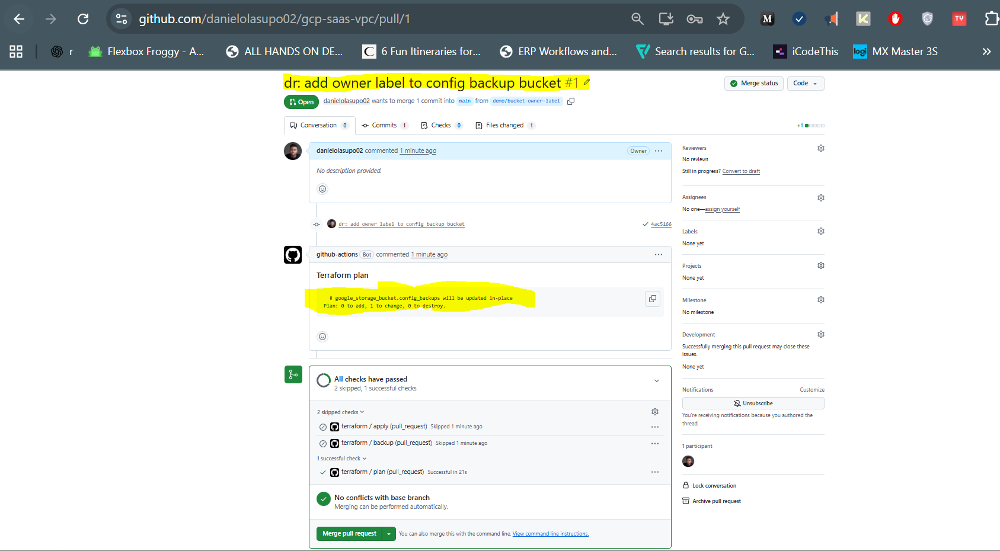

**Apply waiting for approval**
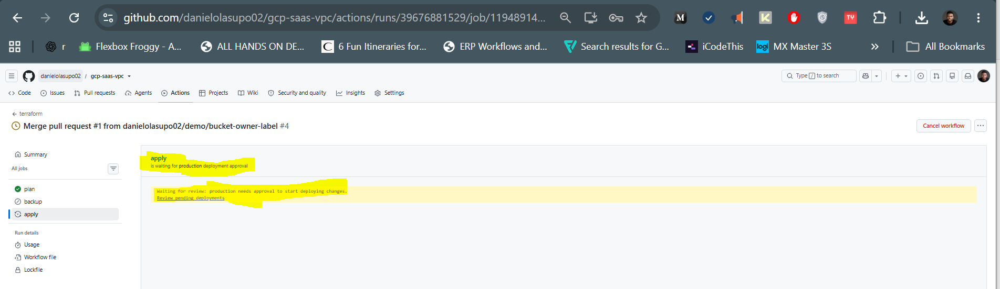

**Apply succeeded**
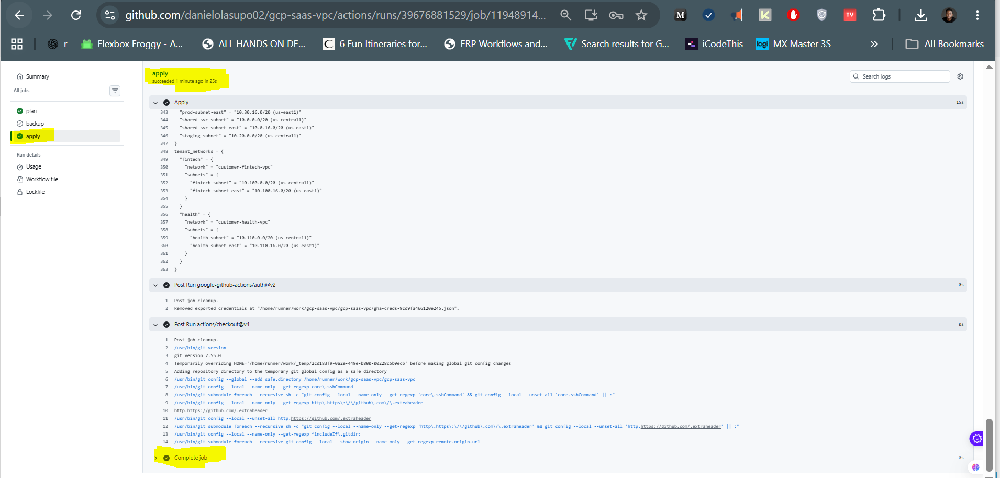

**Manual run: plan + backup**
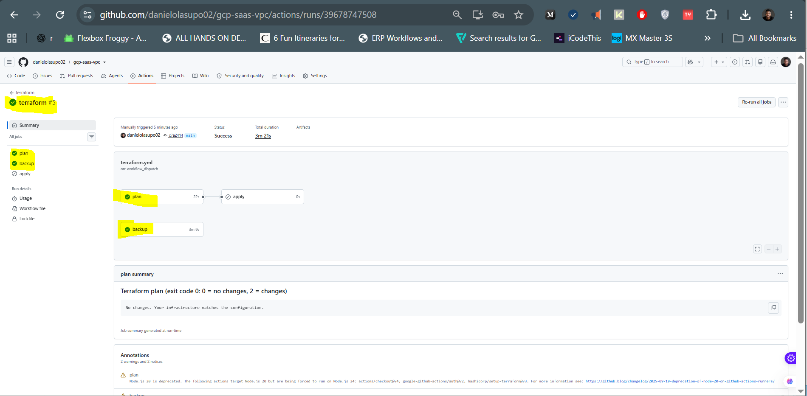

## Notes & Issues

### Cloud Shell `_(1)` uploads
Uploading files one by one again created `*_(1).tf` copies. Fixed with a
`find … -name '*_(1).*'` rename loop. Uploading the zip and running `unzip -o` avoids this.

### Backup hung on a hidden prompt
`gcloud dns … list` in the prod project asked "enable the API? (y/N)", but its
output went to the error log, so it waited forever. Fixed with
`CLOUDSDK_CORE_DISABLE_PROMPTS=1`, so unattended scripts never wait for input.

### Org firewall policy export errors
`firewall-policies rules list` and `associations list` failed. Replaced with a
single `firewall-policies describe`, which returns the rules and associations together.

### Ctrl+C on a pasted block
Ctrl+C stopped only the current command; the queued `down` still ran and
deleted the DR VMs. Long multi-step runs are now done one command at a time.

### First CI run failed at auth
The WIF settings were added as environment variables of `production`, which
only the `apply` job reads. Moved them to repository variables and the email to
a repository secret.

### Workflow file never reached GitHub
The hidden `.github` folder wasn't copied into the local repo. It was created
directly in Git Bash with a heredoc.

### Repo and Cloud Shell out of sync
GitHub still had the Phase 7 `modules/vpc`, so CI `validate` would have failed
on `required_regions`. Synced the repo. Since CI exists, Git is the source of truth.

### Cloud Shell credentials
Terraform again hit `invalid token JSON from metadata`. The workaround is a
`tfauth` shell function that exports `GOOGLE_OAUTH_ACCESS_TOKEN`.

### Decisions
- **Pilot light, not warm standby.** Subnets, routing and security for the DR region exist at zero cost; tenant egress IPs (billable) are created only on failover.
- **Backups in the DR region, separate from the state.** A us-central1 incident can't take out the evidence needed to recover. Terraform state stays in its own versioned bucket.
- **Backups never contain secrets.** State is inventoried (resources, serial, lineage), not copied.
- **IAM for CI stays outside Terraform.** As in Phase 5, the Terraform identity never grants itself or anyone else access.
- **Accepted risk: no DR VPN.** On-prem connectivity is unavailable during a us-central1 outage. A second HA VPN in us-east1 is the next step.
